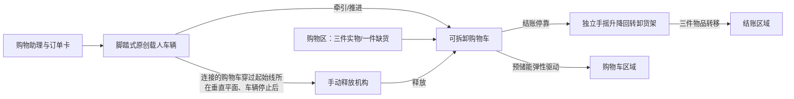

# 01 — 概念、任务分解与系统架构

## 1. 故事概念：星际补给站

月面温室即将断供，OMER 快递员驾驶“星际补给车”执行紧急采购。订单包含生命种子舱、月泉水瓶和太阳能芯片。太阳能芯片缺货，购物助理向顾客提出“风能晶核”替代方案并获得明确批准。三件物品进入结账区后，购物车脱离车辆，沿星轨回到停靠区，完成“最后一公里”配送。

故事只是包装；每个情节必须同步完成真实任务，不得用台词假装完成采购、替代确认、卸货或购物车回归。

## 2. 三件商品与缺货替代

| 订单项 | 购物区状态 | 实际交付 | 舞台识别 |
|---|---|---|---|
| 生命种子舱 | 有货 | 生命种子舱 | 手工雕塑式透明舱体，作为艺术质量重点 |
| 月泉水瓶 | 有货 | 月泉水瓶 | 透明密封瓶，蓝色波纹内衬 |
| 太阳能芯片 | 缺货 | 风能晶核（替代品） | 缺货位置有清晰空位/缺货标记；替代品独立摆放 |

购物助理必须明确说出“太阳能芯片缺货”以及替代品名称，并在车辆操作员/观众可见的情况下取得同意。替代品不能被含糊地当成原物品。

## 3. 系统架构

## 4. 图 A 场地布局与真实任务路线

图 A 标示：起始线位于场地上方、长度 8 英尺；购物区域位于中央；结账区在左下（5×4 英尺）；购物车区域在右下（5×4 英尺）；两个下方区域之间标注 10 英尺间隔，起始线到下方区域标注约 6 英尺。图注明确“不按比例绘制”，这些标注用于理解相对位置，不能替代现场测量。

初始状态必须按题目摆放：车辆和装饰完全在起始线后；购物车至少一个接地点在右下购物车区域；队员和道具在准备区。**购物车不能假设在车辆旁边，也不能在计时开始前预先连接。**

任务路线：
1. 驾驶员从起始线后出发，接收助理订单。
2. 驾驶员驶向右下购物车区域；车辆停稳后，由队员 3 从准备区进入并连接快拆牵引杆/保险销。队员 3 不推动车辆或购物车。
3. 驾驶员牵引购物车进入中央购物区，完成三件物品采购和替代确认。
4. 驾驶员牵引购物车到左下结账区，停靠并完成独立卸货。
5. 结账后驾驶员牵引购物车返回起始线方向；严格按 B11 时序处理购物车穿过起始线垂直平面、车辆停止和释放。
6. 释放后购物车利用自身机械机构回到右下购物车区域；最终静止接地点必须落在区域内。

## 5. 子系统与接口

### A. 载人车辆
- 四轮、低重心、单人脚踏驱动；前轮转向，后轴链传动。
- 驾驶员坐在固定座椅上，脚只接触车载踏板/脚托。
- 车辆有独立制动、机械转向限位、链条防护罩和可快速检查的连接点。
- 车辆宽度设计目标不超过 700 mm（含装饰），以留出标准门口余量；最终按实测门框验证。

### B. 购物车
- 采用低重心篮筐，物品固定在三个独立、可快速取出的软托位中。
- 与车辆通过刚性牵引杆和带保险的快拆销连接。
- 回归动力完全安装在购物车自身，预储能、封闭防护、限速；不使用场地斜坡或外部动力。
- 购物车必须在释放前保持随车移动；不得提前脱钩或单独行驶。

### C. 购物助理
- 由一名队员穿着可识别服装扮演。
- 负责交付订单、批准替代品、结账时逐项检查最终订单。
- 通过“订单板三格状态”向裁判和观众展示：待采购 → 替代已批准 → 三件齐全。

### D. 独立卸货装置
- 自立式底座，不与车辆或购物车连接。
- 手摇绞盘驱动升降滑架；滑架上有三个独立承托篮。
- 旋转臂有 0°/90°机械定位销；到位后翻转承托篮，将三件商品放入结账台。
- 操作员可直接人力操作；整个取物、升起、转移、放下过程必须让裁判看清。

## 5. 设计原则与取舍

- **不采用自动驾驶**：路线短、赛道布局每场可能变化；自动导航增加传感器、调参和失效点，却不直接增加题目分值。
- **不采用无线遥控**：脚踏驱动清晰体现原创推进，避免通信、延迟、电源和失控问题。
- **卸货以机械动作取胜**：升降与回转构成可见的原创功能工程；人工驱动符合 Group II 明确允许的操作方式。
- **购物车回归机制是高风险创新**：弹性驱动具有独立性和视觉效果，但必须先向官方确认解释边界，再通过地面实测。若澄清不支持，采用不依赖储能驱动的合规替代方案并重新验证。

## 6. 性能目标（工程目标，不是规则数值）

- 车辆：载一名实际驾驶员，在平整地面可控起步、转向、制动；最大宽度 ≤700 mm。
- 牵引：购物车满载三件商品时不侧翻、不脱钩、不碰撞车轮。
- 卸货：一次完整循环转移三件商品，目标 ≤60 秒；三件均进入结账区且不掉落。
- 回归：释放后低速、可预测地滚入购物车区域；最终接地点满足区域判定。
- 表演：完整流程目标 7 分 20 秒以内，预留至少 40 秒应急余量。
